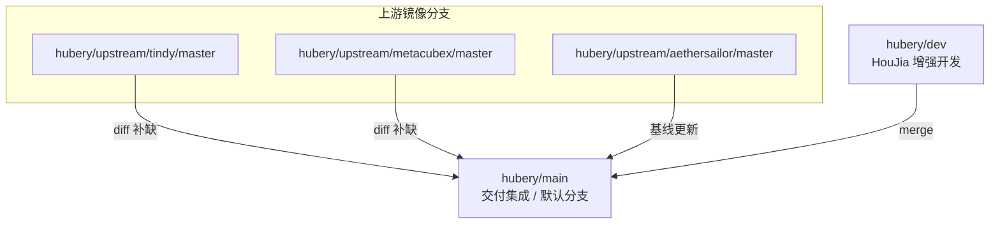

# SubConverter-Extended 分支模型与上游同步（HouJia）

> 2026-10-15 分支改名：`hjsmaster` → `hubery/main`，`hjs-feature` → `hubery/dev`，本文已同步替换。同日三个上游镜像分支改名为 `hubery/upstream/<上游>/<分支>`（见 §2），只能快进更新；`master` 与 Aethersailor 镜像重复，已列入待删清单。

> **仓库（唯一交付仓）**：[HouJia/SubConverter-Extended](https://github.com/HouJia/SubConverter-Extended)  
> **Extended 官方上游**：[Aethersailor/SubConverter-Extended](https://github.com/Aethersailor/SubConverter-Extended)  
> **关联只读参考**：[tindy2013/subconverter](https://github.com/tindy2013/subconverter)、[MetaCubeX/subconverter](https://github.com/MetaCubeX/subconverter)  
> **版本**：2026-05-29（版本号对齐 upstream v1.1.18）

## 目录

- [1. 目标与分支总览](#1-目标与分支总览)
- [2. 分支职责](#2-分支职责)
- [3. 远程与跟踪关系](#3-远程与跟踪关系)
- [4. 日常迭代流程（hubery/dev → hubery/main）](#4-日常迭代流程huberydev--huberymain)
  - [4.3 版本号规则](#43-版本号规则)
- [5. 功能关系与合并策略](#5-功能关系与合并策略)
- [6. 同步 tindy 上游](#6-同步-tindy-上游)
- [7. 同步 MetaCubeX 上游](#7-同步-metacubex-上游)
- [8. 同步 Aethersailor Extended 上游](#8-同步-aethersailor-extended-上游)
  - [8.1 上游改写了历史](#81-上游改写了历史)
- [9. NAS 部署](#9-nas-部署)
- [10. 从 HouJia/subconverter 迁入说明](#10-从-houjiasubconverter-迁入说明)

## 1. 目标与分支总览

在 **SubConverter-Extended 代码基线** 上，保留 NAS 自建能力，并持续吸收 tindy / MetaCubeX 的必要能力（**diff 补缺**，非整分支 merge）。



- **默认分支**：`hubery/main`（GitHub + NAS 构建均以此为准）
- **自建开发**：`hubery/dev`（仅 HouJia 增强；合并进 `hubery/main` 后部署）

## 2. 分支职责

| 分支 | 职责 |
|------|------|
| **`hubery/main`** | **交付集成主分支**：Extended 基线 + 三路上游能力补缺 + 已合并的 `hubery/dev` |
| **`hubery/dev`** | **HouJia 增强开发分支**：NAS、`+houjia.N` 版本、协议补丁、文档等；验证后 merge 到 `hubery/main` |
| **`hubery/upstream/tindy/master`** | tindy `master` 镜像（原 `upstream-subconverter`） |
| **`hubery/upstream/metacubex/master`** | MetaCubeX `master` 镜像（原 `upstream-subconverter-MetaCubeX`） |
| **`hubery/upstream/aethersailor/master`** | Aethersailor `master` 镜像（原 `upstream-SubConverter-Extended`；Extended 基线） |
| 标签 `backup-20260528-tindy-hjsmaster-hubery` | 旧 tindy 集成主线备份（原 `hjsmaster-blk` 分支，只读参考，不部署） |
| 标签 `backup-20260527-aethersailor-extended-master-hubery` | Aethersailor 改写历史前的旧基线（2a308a7） |

镜像分支**只能快进**（pre-push 守卫强制），不在上面提交，也不建本地同名分支，直接用远端跟踪分支推送更新。旧名 `upstream-*` 暂时保留在远端，删除待批准。

**禁止**：在 `hubery/upstream/*` 镜像分支上直接做 NAS / houjia 提交。

## 3. 远程与跟踪关系

```bash
git remote -v
# origin    git@github.com:HouJia/SubConverter-Extended.git
# upstream  git@github.com:Aethersailor/SubConverter-Extended.git
# tindy     git@github.com:tindy2013/subconverter.git
# metacubex git@github.com:MetaCubeX/subconverter.git
```

| Remote | 用途 |
|--------|------|
| `origin` | 推送 `hubery/main`、`hubery/dev`、镜像分支 |
| `upstream` | 更新 `hubery/upstream/aethersailor/master` |
| `tindy` | 更新 `hubery/upstream/tindy/master` |
| `metacubex` | 更新 `hubery/upstream/metacubex/master` |

首次配置示例：

```bash
git remote add tindy git@github.com:tindy2013/subconverter.git
git remote add metacubex git@github.com:MetaCubeX/subconverter.git
# upstream 通常已指向 Aethersailor
```

## 4. 日常迭代流程（hubery/dev → hubery/main）

### 4.1 新功能 / 修复（HouJia 自建）

```bash
git checkout hubery/dev
git pull origin hubery/dev
# … 编辑、测试 …
git commit -m "feat(nas): …"
git push origin hubery/dev

git checkout hubery/main
git merge hubery/dev -m "merge: hubery/dev …"
git push origin hubery/main

./deploy/nas/deploy-to-qnap.sh   # 本机 Docker → NAS
```

### 4.2 原则

- **所有 HouJia 增强**优先提交在 **`hubery/dev`**，避免与上游同步提交混杂。
- **`hubery/main`** 始终可部署；合并前在本地或 NAS 验证构建。
- 版本号 bump（`1.1.18+houjia.N`）在 `hubery/dev` 改，`merge` 后进 `hubery/main` 再部署。

### 4.3 版本号规则

| 段 | 含义 | 示例 |
|----|------|------|
| 主版本 | 当前 `hubery/main` 所基于的 **Aethersailor SubConverter-Extended release** | `1.1.18`（见 [releases](https://github.com/Aethersailor/SubConverter-Extended/releases)） |
| `+houjia.N` | HouJia 在 upstream 之上的补丁层（NAS、三路上游补缺等） | `+houjia.1`、次补丁 `+houjia.2` |

- **merge / rebase 到新 upstream release 时**：将主版本改为该 release（如 `1.1.19`），`houjia` 计数建议从 `1` 重新计。
- **仅 HouJia 小改、未换 upstream 代际时**：只递增 `N`（如 `1.1.18+houjia.1` → `1.1.18+houjia.2`）。
- 写入位置：`src/version.h` 默认值、`deploy/nas/deploy-to-qnap.sh` 的 `VERSION` 构建参数；Docker 构建会覆盖注入到镜像。

## 5. 功能关系与合并策略

三路上游 **无共同 Git 祖先**，无法对 Extended 做常规三路 merge。

| 方式 | 含义 |
|------|------|
| **Extended 为代码基线** | 源码树以 `hubery/upstream/aethersailor/master` / Aethersailor master 为准 |
| **diff 补缺** | 对比 tindy、MetaCubeX 镜像，**逐项移植**补丁到 `hubery/dev` 或 `hubery/main` |
| **hjs 自建** | `deploy/nas/*`、`maxAllowedRulesets=256`、`?ua=`、Hy2 `server_ports` / `hop_interval` 等 |

## 6. 同步 tindy 上游

```bash
git fetch tindy master
git fetch origin
git merge-base --is-ancestor origin/hubery/upstream/tindy/master tindy/master   # 退出码 0 才能继续；否则上游改写过历史，见 §8.1
git push origin tindy/master:refs/heads/hubery/upstream/tindy/master

git checkout hubery/dev   # 或 hubery/main，视补丁归属
# diff origin/hubery/upstream/tindy/master → 移植必要补丁 → commit
git checkout hubery/main
git merge hubery/dev
git push origin hubery/main
```

冲突时 **保留** `deploy/`、`docs/`、`pref.toml`、houjia 模板。

## 7. 同步 MetaCubeX 上游

```bash
git fetch metacubex master
git fetch origin
git merge-base --is-ancestor origin/hubery/upstream/metacubex/master metacubex/master   # 退出码 0 才能继续
git push origin metacubex/master:refs/heads/hubery/upstream/metacubex/master

# diff 补缺 → hubery/dev → merge hubery/main（同 §6）
```

## 8. 同步 Aethersailor Extended 上游

```bash
git fetch upstream master
git fetch origin
git merge-base --is-ancestor origin/hubery/upstream/aethersailor/master upstream/master   # 退出码 0 才能继续；否则见 §8.1
git push origin upstream/master:refs/heads/hubery/upstream/aethersailor/master

git switch hubery/dev
git merge origin/hubery/upstream/aethersailor/master -m "merge(extended): sync Aethersailor master"
# 解决冲突：保留 deploy/nas、houjia 层；验证后合进 hubery/main
git switch hubery/main && git merge --ff-only hubery/dev
git push origin hubery/main hubery/dev
```

不要对 `hubery/main` 做 rebase（不改已推送的历史）。

### 8.1 上游改写了历史

2026-10-15 核对发现：Aethersailor 的 `master` 已改写历史，旧镜像 2a308a7 不再是 `upstream/master` 的祖先（两边各有 263 和 1001 个独有提交），上面的快进检查会失败，守卫也会拒绝推送。处理办法：

1. 先给旧镜像打标签留底（本次已打：`backup-20260527-aethersailor-extended-master-hubery` → 2a308a7，已推送）。
2. **停下来问维护人**，决定是否把镜像重置到新的 `upstream/master`，以及 `hubery/main` 怎么接新基线。不要自行强推。

## 9. NAS 部署

**推荐（本机 Docker 交叉构建）**：

```bash
./deploy/nas/deploy-to-qnap.sh
```

详见 [技术迭代-NAS部署与NPM暴露.md](./技术迭代-NAS部署与NPM暴露.md)。

- 生产镜像 **仅** 从 **`hubery/main`** 构建。
- sub-web 配套仓库：[HouJia/sub-web](https://github.com/HouJia/sub-web) 分支 **`hubery/main`**。

## 10. 从 HouJia/subconverter 迁入说明

2026-05-28 起，原 [HouJia/subconverter](https://github.com/HouJia/subconverter) 的 `hubery/main`、三路上游镜像分支与文档 **迁入本仓库**。

| 原仓库 | 现仓库 |
|--------|--------|
| `HouJia/subconverter` `hubery/main` | **`HouJia/SubConverter-Extended` `hubery/main`** |
| 新建 | **`hubery/dev`**（HouJia 增强迭代） |
| `upstream-*` 镜像分支 | 同名迁入本仓库；2026-10-15 改名为 `hubery/upstream/<上游>/<分支>` |

**`HouJia/subconverter`**：归档只读，新提交请 push 到 **本仓库**。

---

**维护**：变更分支模型时同步更新本文与 `README.md`。
